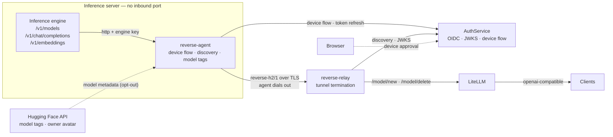

<h1 align="center">ai-reverse</h1>

<p align="center">
  <em>Outbound-only tunnel that publishes a private inference engine to LiteLLM.</em>
</p>

<p align="center">
  <a href="https://github.com/circle-rd/ai-reverse/actions/workflows/ci.yml"></a>
  <a href="LICENSE"></a>
  <a href="https://www.rust-lang.org"></a>
  <a href="https://github.com/circle-rd/ai-reverse/pkgs/container/ai-reverse-agent"></a>
  <a href="deploy/agent/compose.example.yml"></a>
</p>

`reverse-agent` exposes a private OpenAI-compatible inference engine to a relay,
which registers the served models in LiteLLM. The engine never accepts an
inbound connection: the agent dials the relay, upgrades the connection to
HTTP/2, and serves the allowlisted OpenAI routes through the tunnel.



## Security properties

- The agent opens no listener and publishes no port; every connection is
  outbound, initiated by the agent.
- The agent authorizes itself through the AuthService device flow: a human
  approves a short-lived code in the browser, the refresh token and agent id
  are persisted with mode 0600. The credential is forgotten only when the
  identity provider answers `invalid_grant` (expired, reused or revoked refresh
  token). Network failures and provider outages keep it and retry with backoff,
  so a restart during an outage does not require a new approval.
- The relay verifies AuthService-issued access tokens offline against the
  published JWKS; tokens must carry the relay URL as audience and the
  `tunnel:serve` scope. The relay never issues credentials of its own.
- Failed tunnel authentications are counted per client address in a bounded
  state; past the threshold the address is locked out with an `Retry-After`,
  and lockouts double (bounded) on repeat offences while a success clears the
  record. `X-Forwarded-For` is trusted only with `RELAY_TRUST_FORWARDED_FOR`.
- Tunnels are capped globally (`RELAY_MAX_TUNNELS`) and per account
  (`RELAY_MAX_TUNNELS_PER_USER`); both answer `429` without touching the agent.
- Only the allowlisted OpenAI routes cross the tunnel (`GET /v1/models`,
  `POST /v1/{chat/completions,completions,embeddings,embedding,responses,messages,images/generations,audio/transcriptions,audio/speech}`,
  and the OpenAI videos surface as LiteLLM proxies it: `/v1/videos`, its `{id}`,
  `{id}/content` and `{id}/remix`, `edits`, `extensions` and `characters`);
  realtime websockets and queries are never forwarded.
- Caller credentials are never forwarded to the engine and the engine key is
  never sent to the relay; the agent injects the engine key itself.
- The engine key and the agent credential are held in `SecretString` and never
  appear in logs, errors or `Debug` output.
- A rejected engine key is reported to the caller as a generic `502`; the
  caller cannot tell whether the engine, the key or a model exists.
- Model ids are validated once at discovery time. Accounts are always
  `u-<username>`, a namespace no application slug, LiteLLM provider name or relay
  path segment can occupy.
- Request bodies are bounded (64 MiB default) with idle stall guards in both
  directions.
- The runtime image is `scratch`, non-root (UID/GID 65532), read-only, with no
  shell, no package manager, `cap_drop: ALL` and `no-new-privileges`. The optional
  `-gpu` image trades `scratch` for Debian 13 slim to carry nvtop (AGENTS.md, E3).

## Requirements

- Rust 1.89 (pinned in `rust-toolchain.toml`), edition 2024, for local builds.
- A reachable relay (shipped by this repository), an AuthService account and a
  `reverse-agent` OAuth client registered for the device flow with the
  `tunnel:serve` scope and the relay URL as its resource.
- A local OpenAI-compatible engine bound to `127.0.0.1` (or another
  loopback address); TLS to the engine is intentionally unsupported.
- Optional egress for model enrichment: with `AGENT_HF_METADATA=true` (the
  default), model ids are sent to the Hugging Face API over HTTPS
  (`AGENT_HF_URL`) for tags and public owner metadata. Set it to `false` to
  keep model ids on the box; `HTTPS_PROXY`/`NO_PROXY` are honored for this lookup.

## One-command install

`deploy.sh` is attached to each release. It checks the host, finds the local
OpenAI-compatible servers, asks which one to expose when several are running, writes
`compose.yml` and `.env`, pulls the image, starts the agent and prints the device-flow
link.

```bash
curl -fsSL https://github.com/circle-rd/ai-reverse/releases/latest/download/deploy.sh -o deploy.sh
chmod +x deploy.sh
sudo ./deploy.sh
```

Requirements:

- Linux on `amd64` or `arm64`; Ubuntu and Debian are tested, and another Linux with
  Docker works as long as the script's tools are present.
- Docker Engine 20.10 or newer with the Compose v2 plugin (2.20 or newer), and
  `curl`, `ss` (iproute2) and the usual coreutils. Run the script as root or as a
  member of the `docker` group; process names in the server list require root.
- Outbound HTTPS to the relay, the identity provider, and optionally the Hugging Face
  hub. If the GHCR packages are private, run `docker login ghcr.io` first.
- An OpenAI-compatible inference server listening on a local TCP port. The script probes
  `/v1/models`; a single answer is selected automatically, several answers are shown as a
  numbered list.
- GPU metrics are optional. NVIDIA needs the NVIDIA Container Toolkit on the host (the
  script refuses to continue if a GPU is present but the toolkit is not configured); AMD
  and Intel use `/dev/dri`. The `-gpu` image ships nvtop 3.4.

The script accepts `--relay URL`, `--issuer URL`, `--client-id ID`, `--engine-key-file
FILE` and `--install-dir DIR`; without `--relay` and `--issuer` it prompts, or reuses the
existing `.env`. `--auto --model NAME` is the non-interactive form: it selects the server
serving `NAME` and prints only the enrolment URL on stdout. Without `--model`, `--auto`
accepts a single detected server and fails on an ambiguous host. `--dry-run` shows the
generated files without changing the host.

The one-command path requires an OpenAI-compatible engine already running. It does not
install an engine, Docker or the NVIDIA Container Toolkit. See the manual quickstart
below for a pre-written compose file.

## Quickstart (container)

```bash
docker login ghcr.io
cp deploy/agent/.env.example deploy/agent/.env   # then edit it
mkdir -p deploy/agent/secrets
install -m 600 /dev/stdin deploy/agent/secrets/upstream_api_key <<< "$ENGINE_KEY"
cd deploy/agent
docker compose pull
docker compose up -d
docker compose logs -f reverse-agent
```

On the first start the agent begins the device flow and prints a verification
link and a user code; open the link, sign in and approve. The refresh token and
the agent id are kept in the `agent-state` volume and reused across restarts.
A restart reuses them without asking for approval; a new approval is needed only
after the provider rejects the refresh token. The refresh token rotates on each
renewal and, with the provider's default policy, expires after 30 days without
use.

Equivalent plain `docker run`:

```bash
docker run --rm --network host --read-only --cap-drop ALL \
  --security-opt no-new-privileges --ulimit core=0 \
  -v reverse-agent-state:/var/lib/reverse-agent \
  --env-file .env \
  ghcr.io/circle-rd/ai-reverse-agent:latest
```

If you uncomment the file form of the engine key, bind-mount it for the plain
`docker run` too (`-v $PWD/secrets/upstream_api_key:/run/secrets/upstream_api_key:ro`).

### Relay

The relay terminates agent tunnels and registers the announced models in
LiteLLM. It publishes **only** the tunnel listener; the OpenAI surface stays on
the private network for LiteLLM to call.

```bash
cp deploy/relay/.env.example deploy/relay/.env   # then edit it
cd deploy/relay
docker compose -f compose.example.yml pull
docker compose -f compose.example.yml up -d
```

The compose example expects a Traefik network and routes
`relay.example.com` to the tunnel listener. Do not route the API listener
(`RELAY_API_LISTEN`) through the proxy. Behind Traefik, keep
`RELAY_TRUST_FORWARDED_FOR=true`.

## Configuration

Required settings have no silent defaults. Supplying both `KEY` and
`KEY_FILE` is rejected. Logs are JSON on stdout; `RUST_LOG` overrides the
`info` default.

| Variable | Required | Description |
| --- | --- | --- |
| `AGENT_RELAY_URL` | yes | Relay origin, `http(s)://host[:port]`. `https` in production. |
| `AGENT_UPSTREAM_URL` | yes | Local engine origin; `https` is rejected, plain `http` only. |
| `AGENT_AUTH_ISSUER` | yes | AuthService origin, `https` in production (loopback may be `http`). |
| `AGENT_AUTH_CLIENT_ID` | yes | OAuth client registered for the device flow. |
| `AGENT_AUTH_RESOURCE` | no | Audience requested for the access token. Default: the relay origin. |
| `AGENT_AUTH_SCOPE` | no | Scopes requested at authorization. Default `openid profile offline_access tunnel:serve`. |
| `AGENT_UPSTREAM_API_KEY` | no* | Engine bearer key. |
| `AGENT_UPSTREAM_API_KEY_FILE` | no* | File alternative; exactly one form per secret. |
| `AGENT_CREDENTIAL_FILE` | no | Where the refresh token and agent id are kept. Default `/var/lib/reverse-agent/credential`. |
| `AGENT_MACHINE_ID_FILE` | no | Read-only host machine-id used to derive a private host pseudonym. Mount the host file into containers; do not share an agent credential. |
| `AGENT_HOSTNAME` | no | Operator-declared local hostname for the owner's private inventory. Never use an IP-derived or reverse-DNS name. |
| `AGENT_MODELS_POLL_SECS` | no | Interval between engine model-list polls. Default 5. |
| `AGENT_RECONNECT_MIN_SECS` | no | First reconnect delay. Default 1. |
| `AGENT_RECONNECT_MAX_SECS` | no | Reconnect delay ceiling. Default 30. |
| `AGENT_CONNECT_TIMEOUT_SECS` | no | Bound on TCP connect and tunnel upgrade. Default 5. |
| `AGENT_UPSTREAM_HEADERS_TIMEOUT_SECS` | no | Engine answer deadline. Default 900. |
| `AGENT_IDLE_TIMEOUT_SECS` | no | Body stall limit, both directions. Default 600. |
| `AGENT_MAX_REQUEST_BYTES` | no | Largest request body accepted. Default 67108864. |
| `AGENT_INSECURE_TRANSPORT` | no | Allow plain HTTP to a non-loopback relay. Default `false`. |
| `AGENT_EXTRA_MODELS` | no | Comma-separated ids announced in addition to the engine's `/v1/models`. |
| `AGENT_MODEL_TAGS` | no | `model=tag[,tag][;…]`; optional override that replaces every detected tag for the named models. |
| `AGENT_HF_METADATA` | no | `true`/`false`: consult the hub for model capabilities, author claims and public owner avatars. Default `true`. |
| `AGENT_HF_URL` | no | Hub origin; `https` unless loopback. Default `https://huggingface.co`. |
| `AGENT_HF_TOKEN` | no | Token for gated or private hub repositories. |
| `AGENT_HF_TIMEOUT_SECS` | no | Bound on each Hub request. Default 5. |
| `AGENT_MAX_SLOTS` | no | Concurrent requests the engine accepts, for engines that do not report it (SGLang, vLLM). A positive integer; wins over what the engine reports. |
| `AGENT_BENCHMARK` | no | `true`/`false`: once the engine is up, send one fixed short generation to a text model and record time-to-first-token and tokens per second. Default `true`. |
| `AGENT_STATUS_POLL_SECS` | no | Interval between load samples of the engine, host and GPUs. Default 5. |

`*` Exactly one of the direct and `_FILE` forms is required when the secret is
set. Secrets are never echoed in errors or logs.

Plain-text transport to a non-loopback relay is refused unless
`AGENT_INSECURE_TRANSPORT=true` is set explicitly.

### Relay settings

| Variable | Required | Description |
| --- | --- | --- |
| `RELAY_TUNNEL_LISTEN` | yes | `ip:port` where agents dial the tunnel. |
| `RELAY_API_LISTEN` | yes | `ip:port` of the OpenAI surface LiteLLM calls; never publish it. |
| `RELAY_PUBLIC_URL` | yes | Public tunnel origin as agents and the identity provider see it. |
| `RELAY_PUBLIC_API_BASE` | yes | Origin LiteLLM uses to reach `RELAY_API_LISTEN`; the relay appends `/{account}/…`, where `{account}` is `u-<username>`. |
| `RELAY_API_KEY` | yes* | Bearer key LiteLLM presents; injected into registered deployments. |
| `RELAY_AUTH_ISSUER` | yes | AuthService origin issuing agent tokens. |
| `RELAY_AUTH_AUDIENCE` | no | Required token audience. Default: `RELAY_PUBLIC_URL`. |
| `RELAY_AUTH_SCOPE` | no | Required token scope. Default `tunnel:serve`. |
| `RELAY_LITELLM_URL` | yes | LiteLLM admin API origin. |
| `RELAY_LITELLM_API_KEY` | no* | Dedicated management key (recommended). |
| `RELAY_LITELLM_MASTER_KEY` | no* | Fallback management key; logs `relay.litellm_master_key_fallback`. |
| `RELAY_LITELLM_PROVIDER` | no | Provider prefix of deployments. Default `hosted_vllm`. |
| `RELAY_MODELS_POLL_SECS` | no | Agent model-list poll interval. Default 5. |
| `RELAY_DEREGISTER_GRACE_SECS` | no | How long a vanished model stays registered. Default 30. |
| `RELAY_RECONCILE_INTERVAL_SECS` | no | Desired-vs-actual reconcile period. Default 2. |
| `RELAY_RESYNC_INTERVAL_SECS` | no | Full LiteLLM resync period. Default 60. |
| `RELAY_REQUEST_HEADERS_TIMEOUT_SECS` | no | Agent answer deadline. Default 900. |
| `RELAY_IDLE_TIMEOUT_SECS` | no | Body stall limit, both directions. Default 600. |
| `RELAY_MAX_REQUEST_BYTES` | no | Largest request body accepted. Default 67108864. |
| `RELAY_LITELLM_TIMEOUT_SECS` | no | Bound on one LiteLLM admin call. Default 15. |
| `RELAY_MAX_TUNNELS` | no | Global cap on upgraded tunnels. Default 256. |
| `RELAY_MAX_TUNNELS_PER_USER` | no | Per-account tunnel cap. Default 64. |
| `RELAY_AUTH_FAILURE_THRESHOLD` | no | Failed auth attempts before lockout. Default 5. |
| `RELAY_AUTH_FAILURE_WINDOW_SECS` | no | Window counting failures. Default 60. |
| `RELAY_AUTH_LOCKOUT_SECS` | no | Initial lockout; doubles up to 8x. Default 60. |
| `RELAY_TRUST_FORWARDED_FOR` | no | `true`/`false`: trust the last `X-Forwarded-For` entry. Default `false`. |
| `RELAY_CATALOGUE_CLIENT_ID` | no* | Confidential auth-service client the relay uses to notify model changes; `reverse-relay` when provisioned by the LiteLLM setup. |
| `RELAY_CATALOGUE_CLIENT_SECRET` | no* | Secret of that client; `_FILE` form accepted. |
| `RELAY_INVENTORY_URL` | no | HTTPS endpoint that receives the inventory and answers with the owners' settings (see "Owner settings"). Set with the next two or none. |
| `RELAY_INVENTORY_SECRET` | no* | Shared secret that signs each push; `_FILE` form accepted. |
| `RELAY_INVENTORY_RELAY_ID` | no* | Names this relay: 1 to 63 lowercase letters, digits or dashes. |
| `RELAY_INVENTORY_INTERVAL_SECS` | no | Interval between pushes, which is also the heartbeat of the live status. Default 15. |

`*` The two catalogue variables are set together or not at all. Without them the
relay stays silent and auth-service picks up model changes on its 5-minute sync.
With them, each change of the served model set is announced to auth-service at
`RELAY_AUTH_ISSUER` (`POST /api/internal/gateway/inventory-changed`) with a
`gateway:inventory:sync` client-credentials token, so its model pickers refresh at
once. The LiteLLM setup of auth-service provisions that client and its scope; the
`RELAY_AUTH_ISSUER` must be the auth-service `BETTER_AUTH_URL` (the token audience).

Exactly one of the direct and `_FILE` forms is required per secret. Supply
`RELAY_LITELLM_API_KEY` in production; the master key falls back only for
bootstrap and logs a warning. Both credentials can manage only deployments
tagged `model_info.managed_by = "reverse-relay"`.

## Owner settings: price and parallel requests

The relay keeps no durable state, so the owner's decisions live with the application
that owns them (raiversed). With `RELAY_INVENTORY_URL` set, the relay polls each agent's
`/_agent/status` and every `RELAY_INVENTORY_INTERVAL_SECS` pushes one signed snapshot of
everything connected; the answer carries the settings of the models in it.

- **Push.** `POST` of `{ relayId, generatedAt, nodes[] }` (`generatedAt` is Unix
  milliseconds and never goes backwards). Each node has `nodeId` (the agent instance id),
  `ownerSub`, `ownerName` (`u-<username>`), `hardware`, `status` and `models[]`
  (`{ name, tags }`). A node absent from a snapshot is offline; on shutdown the relay
  pushes one last snapshot with no node. No IP address or hostname is sent. The header
  `x-relay-signature: t=<unix seconds>,v1=<hex>` is the HMAC-SHA256 of `<t>.<body>`
  with the shared secret; the receiver checks it in constant time and refuses an old `t`.
- **Answer.** `200` with `{ "settings": [{ "model": "u-<user>/<model>", "maxSlots": 4,
  "pricing": { "inputUsdPerMtok": "0.30", "outputUsdPerMtok": "1.20",
  "cacheReadUsdPerMtok": null, "cacheWriteUsdPerMtok": null } }] }`. Prices are plain
  decimal strings in **US dollars per million tokens** (at most 6 decimals); `maxSlots` is
  1 to 100000. The answer is authoritative: a model absent from it has no settings, so it
  is served unpriced and unlimited, and a price of `"0"` serves it free on purpose.
- **Applied to LiteLLM.** `litellm_params.max_parallel_requests`, and the costs per token
  (`input_cost_per_token`, `output_cost_per_token`, `cache_read_input_token_cost`,
  `cache_creation_input_token_cost`) in both `litellm_params` (routing) and `model_info`
  (billing), plus the settings as received in `model_info.reverse_settings`. A change
  replaces the deployment, like any change of `model_info`.
- **Fail loud.** An answer that is not `200`, is not valid JSON, holds one invalid price or
  slot limit, or names a model twice is refused whole and the relay keeps the settings it
  had; it never drops one entry and serves that model unpriced. If the receiver stays
  unreachable the last settings stay in force, and a restarted relay serves unpriced
  until the first answer.
- **Parallel requests.** LiteLLM counts `max_parallel_requests` per proxy worker, not
  across workers or pods; a request over it is refused at once with a 429 and fails over
  to another deployment of the model group in current releases, while older ones queued.
  Check the behaviour of the LiteLLM version you run.

## Model announcement and tags

Every discovered model is announced to the relay with capability tags that
downstream consumers (LiteLLM, dashboards, SDKs) use to classify it.

- **Discovery.** The agent polls the engine's `/v1/models`. Engines commonly
  omit auxiliary lanes: `AGENT_EXTRA_MODELS` announces ids such as an embedding
  model the engine serves on `/v1/embeddings` without listing it.
- **Classification.** The agent merges four sources: the capabilities the engine
  declares on its own endpoints, the capability hints it reports in each
  `/v1/models` entry (`capabilities` or `tags`, including
  `input_modalities`/`output_modalities`), the Hugging Face model API's
  `pipeline_tag` and `tags`, and the operator's `AGENT_MODEL_TAGS` override.
  The engine is recognised by the endpoint it answers, once per announced set of
  ids; nothing is inferred from a name:

  | Engine | Endpoint | Tags read |
  | --- | --- | --- |
  | Ollama | `GET /api/tags`, then `POST /api/show` per model | the `capabilities` list: `completion` → `text`, `tools`, `vision`, `embedding`, `audio` → `speech`, … |
  | SGLang | `GET /model_info`, or `/get_model_info` | `is_generation` → `text` or `embedding`; `has_image_understanding` → `vision`; `has_audio_understanding` → `speech` |
  | llama.cpp | `GET /props` | `modalities` (`vision`, `audio`, `video`); a `chat_template` → `text`; `chat_template_caps.supports_tools` → `tools` |
  | vLLM | none | nothing: the hub or the override decides |

  The engine facts describe the one model SGLang or llama.cpp serves, so they apply
  to every id it announces. Typical hub mappings are `feature-extraction` →
  `embedding`, `text-generation` → `text`, `image-text-to-text` → `text` +
  `vision`, `text-to-image` → `image`, `automatic-speech-recognition` →
  `speech`, and `text-ranking` → `rerank`. Results are cached; unknown or
  unreachable models are re-checked after 15 minutes. One bounded enrichment
  pass runs per poll cycle (`AGENT_HF_TIMEOUT_SECS`), so a slow hub can never
  postpone the announcement of newly discovered models: they are announced
  first, then enriched.
- **Owner image.** For `namespace/model` ids found on the hub, the agent records
  the namespace as `hub_owner` and looks up its public user or organization
  profile. The public `avatarUrl` is accepted only over HTTPS from the configured
  Hub domain or Hugging Face; avatar results are cached per namespace. The owner
  is the repository namespace, not necessarily the original model publisher or
  inference provider.
- **Author safety claims.** Exact Hub tags `uncensored` and `abliterated` are
  exposed as `model_info.author_safety_claim` (`uncensored`, `abliterated`, or
  `uncensored-and-abliterated`). These are author-declared labels, not a safety
  evaluation; absent tags remain unknown, and names are never used to guess.
- **Override.** `AGENT_MODEL_TAGS` is optional. When set for a model it replaces
  every detected tag of that model, for ids the engine and hub do not classify, or
  to correct a fact the server does not report:

  ```bash
  AGENT_EXTRA_MODELS=perplexity-ai/pplx-embed-v1-0.6b
  AGENT_MODEL_TAGS=qwen3.8-flash-next=text,tools
  ```

- A model with no source, no engine endpoint and no override carries **no** tags;
  the agent logs `models.tags_unknown` instead of guessing.
- The relay publishes tags in `model_info.tags`, owner data in
  `model_info.hub_owner` and `model_info.hub_avatar_url`, and author claims in
  `model_info.author_safety_claim`. It maps capability tags to LiteLLM fields:
  `tools` → `supports_function_calling`, `vision` → `supports_vision`, `video` →
  `supports_video_input`, `speech` → `supports_audio_input` +
  `supports_audio_output`, and `embedding` → `model_info.mode = "embedding"`. A
  flag is only set when its tag is present, so an unclassified model is never
  asserted to lack a capability. Image and rerank models keep their tag but stay
  on the chat surface: the relay does not serve their dedicated routes.
- Each deployment carries `model_info.managed_by = "reverse-relay"` and
  `model_info.created_by = "{account}"`, in addition to `client_id` and
  `reverse_name`. This distinguishes models learned by the relay from models
  configured directly in LiteLLM, even when both have the same owner.
- Each deployment carries `model_info.hardware`: the self-reported host facts
  (`kind`, `product`, `vendor`, `gpus`, `memoryMb`, `cpuArch`, `cpuCores`) of the
  connected agents that serve the model, distinct and ordered by node id. The
  relay reads them once per tunnel from `/_agent/info`; an agent without that
  endpoint, or a failed read, publishes no hardware. The facts are not verified:
  consumers must treat them as declarations, never for billing or authorization.
- **Private host identity.** To correlate agents on one host, give each agent
  `AGENT_MACHINE_ID_FILE` pointing to the same host `/etc/machine-id`; in a container,
  bind-mount that file read-only. The agent sends an application-specific pseudonym,
  never the machine-id itself. The relay scopes it to the verified owner before
  including `hostId` in the private inventory. `AGENT_HOSTNAME` optionally adds the
  operator-declared local hostname there. Neither field is sent in LiteLLM model
  metadata. Do not configure an IP-derived or reverse-DNS hostname. Both fields are
  self-reported; a restored or cloned machine-id identifies the same host and a
  replacement machine-id changes the identifier. Existing agents may omit them.
- The agent also serves its live status at `/_agent/status` through the tunnel
  (never to the public): the engine family and version, its running and queued
  requests and slot capacity, a capacity state (`offline`, `idle`, `busy`,
  `occupied`), the host uptime, CPU load, memory use and hottest thermal zone,
  each GPU's utilisation, memory share, temperature and power draw, and the
  agent's own speed test. A figure the agent cannot read is `-1`, never `0`.
  This status is not written to `model_info`: it changes every few seconds and
  would make the relay replace the deployment continuously.
  - **Engine metrics.** The engine family is recognised from its Prometheus
    metrics (`sglang:`, `vllm:`, `llamacpp:`). Start the engine with its metrics
    option (`--enable-metrics` for SGLang, `--metrics` for llama.cpp) or the
    status carries `hint: "metrics-disabled"`. llama.cpp reports its slot count
    through `/props`; SGLang and vLLM do not expose their capacity, so set
    `AGENT_MAX_SLOTS` or the status carries `hint: "capacity-not-exposed"`.
    Without engine metrics the load falls back to the requests crossing the agent.
  - **GPU figures** come from `nvtop -s` (NVIDIA on x86 and ARM, AMD, Intel), run by
    the agent with an empty environment. It uses the first `nvtop` on its `PATH`: an
    agent installed natively uses the host's, and the `-gpu` image uses the 3.4.0 it
    ships (below). A container cannot borrow the host's binary, which is linked
    against the host's libraries. Without `nvtop`, or without GPU access, `gpus` is
    empty. Values are device-wide, so a container reports what the host would, with
    two rules: memory in use is computed from `mem_used` and `mem_total`, never from
    `mem_util` (the memory controller activity on NVIDIA before nvtop 3.3), so an old
    nvtop gives `-1` rather than a wrong number; and on a unified-memory GB10 the
    memory share is the system memory share (`memoryShared`), because the snapshot's
    own figure only counts the GPU processes the caller can see.
    Each GPU also lists the processes holding its memory (`processes`: `pid`, kernel
    executable `name` from `/proc/<pid>/comm`, `memoryMib`). The command line is never
    read, since it can carry secrets. The list is visible only when the agent shares
    the host's PID namespace (`pid: host`) and the GPU is passed through the NVIDIA
    container toolkit (`--gpus`); otherwise it is empty.
- Changing tags, owner, avatar, author claim, capability flags or hardware replaces the
  deployment on the next reconcile: LiteLLM has no partial `model_info` update,
  so the old row is deleted and recreated with the new metadata.
- The account is `u-` plus the lowercase `preferred_username` of the access
  token (up to 63 characters, so 65 in total). A token without
  `preferred_username` is refused; the relay never falls back to `sub`. A user
  `bmz` therefore publishes `u-bmz/{model}`, which AuthService declares as a
  resource owned by that user.
- The relay registers one deployment per `{account}/{model}` alias. Several
  agents of the same account that announce the same model id share that alias
  and are load-balanced by the relay; the deployment stays while at least one
  agent serves it and is removed after the grace period once none does.

### Upgrading to `u-<username>` accounts

Before this change the account was the bare username (`bmz/{model}`). On the
next tunnel after the relay upgrade, reconcile deletes the `bmz/…` deployments
and creates the `u-bmz/…` ones, so the models are briefly unavailable and
clients must switch to the new names. The AuthService objects, links and
resources recorded for the old names become stale and are purged on the
AuthService side. Agents need no change: they never know the account, which the
relay derives from the device-grant token.

Tags: `text`, `tools`, `vision`, `image`, `video`, `speech`, `embedding`,
`rerank`.

Classification is enrichment, never a serving dependency: a failed lookup or an
air-gapped box degrades the tags and optional display metadata only. With
`AGENT_HF_METADATA=false` the agent never contacts the hub, so model ids stay on
the box.

## Container images

The workflows publish `ghcr.io/circle-rd/ai-reverse-agent` (`Dockerfile`),
`ghcr.io/circle-rd/ai-reverse-agent-gpu` (`Dockerfile`, target `gpu`) and
`ghcr.io/circle-rd/ai-reverse-relay` (`Dockerfile.relay`) for `linux/amd64` and
`linux/arm64`:

| Tag | Source |
| --- | --- |
| `nightly` | Manual dispatch (`nightly.yml`), builds the images from `develop` by default; superseded nightly versions are deleted. |
| `latest`, `X.Y`, `X.Y.Z` | Git tags `v*` (`release.yml`), every image. |

Pin the image by digest in production.

### GPU image

`ai-reverse-agent-gpu` is the same agent on Debian 13 slim next to nvtop 3.4.0 (built
from a pinned, checksummed release; GPL-3, licence and source pointer in
`/usr/share/doc/nvtop`), so the status carries GPU load, memory, temperature and power
(AGENTS.md, exception E3). It keeps the non-root user, read-only root and
`cap_drop: ALL`. Give it the GPU with `gpus: all` (the image already sets
`NVIDIA_DRIVER_CAPABILITIES=utility`); for an AMD or Intel GPU pass `/dev/dri` and the
`render` group instead. Add `pid: host` so nvtop lists the GPU processes of the host.
The NVIDIA container toolkit must be installed on the host: it injects the driver
libraries that nvtop reads, they are not in the image. See
`deploy/agent/compose.example.yml`.

## Run with Cargo

```bash
export AGENT_RELAY_URL=https://relay.example.com
export AGENT_UPSTREAM_URL=http://127.0.0.1:30001
cargo run --locked
```

## Build and quality gates

```bash
cargo fmt --all --check
cargo clippy --workspace --all-targets --all-features --locked -- -D warnings
cargo test --workspace --all-targets --all-features --locked
RUSTDOCFLAGS="-D warnings" cargo doc --workspace --no-deps --locked
cargo audit
docker build -t reverse-agent -f Dockerfile .
docker build -t reverse-relay -f Dockerfile.relay .
```

`Cargo.lock` is committed and every build uses `--locked`. The toolchain is
pinned to 1.89.0 in `rust-toolchain.toml`.

## Project layout

```
crates/
├── reverse-core/    # wire contract, validated identifiers, env parsing,
│                    # secrets, bounded bodies, tunnel allowlist, logging, shutdown
├── reverse-agent/   # binary: device flow, tunnel, discovery, proxy, engine client
└── reverse-relay/   # binary: tunnel termination, token verification, model registrar
deploy/agent/        # pull-based compose example + .env.example
deploy/relay/        # Traefik-ready compose example + .env.example
```

The LiteLLM PoC recipes and the local development stacks live in the ignored
`validation/` directory; see [AGENTS.md](AGENTS.md) section 10.

## License

MIT. See [LICENSE](LICENSE).
