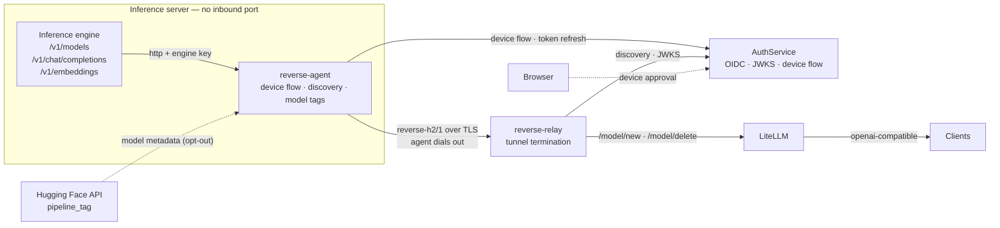

<h1 align="center">ai-reverse</h1>

<p align="center">
  <em>Outbound-only tunnel that publishes a private inference engine to LiteLLM.</em>
</p>

<p align="center">
  <a href="https://github.com/circle-rd/ai-reverse/actions/workflows/ci.yml"></a>
  <a href="LICENSE"></a>
  <a href="https://www.rust-lang.org"></a>
  <a href="https://github.com/circle-rd/ai-reverse/pkgs/container/ai-reverse-agent"></a>
  <a href="deploy/agent/compose.example.yml"></a>
</p>

`reverse-agent` exposes a private OpenAI-compatible inference engine to a relay,
which registers the served models in LiteLLM. The engine never accepts an
inbound connection: the agent dials the relay, upgrades the connection to
HTTP/2, and serves the allowlisted OpenAI routes through the tunnel.



## Security properties

- The agent opens no listener and publishes no port; every connection is
  outbound, initiated by the agent.
- The agent authorizes itself through the AuthService device flow: a human
  approves a short-lived code in the browser, the refresh token and agent id
  are persisted with mode 0600, and they are forgotten when the identity
  provider stops accepting them.
- The relay verifies AuthService-issued access tokens offline against the
  published JWKS; tokens must carry the relay URL as audience and the
  `tunnel:serve` scope. The relay never issues credentials of its own.
- Failed tunnel authentications are counted per client address in a bounded
  state; past the threshold the address is locked out with an `Retry-After`,
  and lockouts double (bounded) on repeat offences while a success clears the
  record. `X-Forwarded-For` is trusted only with `RELAY_TRUST_FORWARDED_FOR`.
- Tunnels are capped globally (`RELAY_MAX_TUNNELS`) and per account
  (`RELAY_MAX_TUNNELS_PER_USER`); both answer `429` without touching the agent.
- Only the allowlisted OpenAI routes cross the tunnel (`GET /v1/models`,
  `POST /v1/{chat/completions,completions,embeddings,embedding,responses,messages}`);
  queries are never forwarded.
- Caller credentials are never forwarded to the engine and the engine key is
  never sent to the relay; the agent injects the engine key itself.
- The engine key and the agent credential are held in `SecretString` and never
  appear in logs, errors or `Debug` output.
- A rejected engine key is reported to the caller as a generic `502`; the
  caller cannot tell whether the engine, the key or a model exists.
- Model ids are validated once at discovery time; LiteLLM provider names and
  relay path segments are reserved client ids.
- Request bodies are bounded (64 MiB default) with idle stall guards in both
  directions.
- The runtime image is `scratch`, non-root (UID/GID 65532), read-only, with no
  shell, no package manager, `cap_drop: ALL` and `no-new-privileges`.

## Requirements

- Rust 1.89 (pinned in `rust-toolchain.toml`), edition 2024, for local builds.
- A reachable relay (shipped by this repository), an AuthService account and a
  `reverse-agent` OAuth client registered for the device flow with the
  `tunnel:serve` scope and the relay URL as its resource.
- A local OpenAI-compatible engine bound to `127.0.0.1` (or another
  loopback address); TLS to the engine is intentionally unsupported.
- Optional egress for model classification: with the default
  `AGENT_HF_METADATA=true` by default, model ids are sent to the Hugging Face
  API over HTTPS (`AGENT_HF_URL`). Set it to `false` to keep model ids on the box;
  `HTTPS_PROXY`/`NO_PROXY` are honored for this lookup.

## Quickstart (container)

```bash
docker login ghcr.io
cp deploy/agent/.env.example deploy/agent/.env   # then edit it
mkdir -p deploy/agent/secrets
install -m 600 /dev/stdin deploy/agent/secrets/upstream_api_key <<< "$ENGINE_KEY"
cd deploy/agent
docker compose pull
docker compose up -d
docker compose logs -f reverse-agent
```

On the first start the agent begins the device flow and prints a verification
link and a user code; open the link, sign in and approve. The refresh token and
the agent id are kept in the `agent-state` volume and reused across restarts.

Equivalent plain `docker run`:

```bash
docker run --rm --network host --read-only --cap-drop ALL \
  --security-opt no-new-privileges --ulimit core=0 \
  -v reverse-agent-state:/var/lib/reverse-agent \
  --env-file .env \
  ghcr.io/circle-rd/ai-reverse-agent:latest
```

If you uncomment the file form of the engine key, bind-mount it for the plain
`docker run` too (`-v $PWD/secrets/upstream_api_key:/run/secrets/upstream_api_key:ro`).

## Configuration

Required settings have no silent defaults. Supplying both `KEY` and
`KEY_FILE` is rejected. Logs are JSON on stdout; `RUST_LOG` overrides the
`info` default.

| Variable | Required | Description |
| --- | --- | --- |
| `AGENT_RELAY_URL` | yes | Relay origin, `http(s)://host[:port]`. `https` in production. |
| `AGENT_UPSTREAM_URL` | yes | Local engine origin; `https` is rejected, plain `http` only. |
| `AGENT_AUTH_ISSUER` | yes | AuthService origin, `https` in production (loopback may be `http`). |
| `AGENT_AUTH_CLIENT_ID` | yes | OAuth client registered for the device flow. |
| `AGENT_AUTH_RESOURCE` | no | Audience requested for the access token. Default: the relay origin. |
| `AGENT_AUTH_SCOPE` | no | Scopes requested at authorization. Default `openid profile offline_access tunnel:serve`. |
| `AGENT_UPSTREAM_API_KEY` | no* | Engine bearer key. |
| `AGENT_UPSTREAM_API_KEY_FILE` | no* | File alternative; exactly one form per secret. |
| `AGENT_CREDENTIAL_FILE` | no | Where the refresh token and agent id are kept. Default `/var/lib/reverse-agent/credential`. |
| `AGENT_MODELS_POLL_SECS` | no | Interval between engine model-list polls. Default 5. |
| `AGENT_RECONNECT_MIN_SECS` | no | First reconnect delay. Default 1. |
| `AGENT_RECONNECT_MAX_SECS` | no | Reconnect delay ceiling. Default 30. |
| `AGENT_CONNECT_TIMEOUT_SECS` | no | Bound on TCP connect and tunnel upgrade. Default 5. |
| `AGENT_UPSTREAM_HEADERS_TIMEOUT_SECS` | no | Engine answer deadline. Default 900. |
| `AGENT_IDLE_TIMEOUT_SECS` | no | Body stall limit, both directions. Default 600. |
| `AGENT_MAX_REQUEST_BYTES` | no | Largest request body accepted. Default 67108864. |
| `AGENT_INSECURE_TRANSPORT` | no | Allow plain HTTP to a non-loopback relay. Default `false`. |
| `AGENT_EXTRA_MODELS` | no | Comma-separated ids announced in addition to the engine's `/v1/models`. |
| `AGENT_MODEL_TAGS` | no | `model=tag[,tag][;…]`; overrides hub metadata for the named models. |
| `AGENT_HF_METADATA` | no | `true`/`false`: consult the hub to classify models. Default `true`. |
| `AGENT_HF_URL` | no | Hub origin; `https` unless loopback. Default `https://huggingface.co`. |
| `AGENT_HF_TOKEN` | no | Token for gated or private hub repositories. |
| `AGENT_HF_TIMEOUT_SECS` | no | Bound on one metadata lookup. Default 5. |

`*` Exactly one of the direct and `_FILE` forms is required when the secret is
set. Secrets are never echoed in errors or logs.

Plain-text transport to a non-loopback relay is refused unless
`AGENT_INSECURE_TRANSPORT=true` is set explicitly.

## Model announcement and tags

Every discovered model is announced to the relay with capability tags that
downstream consumers (LiteLLM, dashboards, SDKs) use to classify it.

- **Discovery.** The agent polls the engine's `/v1/models`. Engines commonly
  omit auxiliary lanes: `AGENT_EXTRA_MODELS` announces ids such as an embedding
  model the engine serves on `/v1/embeddings` without listing it.
- **Classification.** The agent asks the Hugging Face model API for the model's
  `pipeline_tag`, the hub's normalized classification, and maps it to a tag
  (`feature-extraction` → `embedding`, `text-generation` → `text`,
  `image-text-to-text` → `text` + `vision`, `text-to-image` → `image`,
  `automatic-speech-recognition` → `speech`, `text-ranking` → `rerank`, …).
  Results are cached; unknown or unreachable models are re-checked after 15
  minutes. One bounded classification pass runs per poll cycle
  (`AGENT_HF_TIMEOUT_SECS`), so a slow hub can never postpone the announcement
  of newly discovered models: they are announced first, then enriched.
- **Override.** `AGENT_MODEL_TAGS` wins over the hub, for internal ids the hub
  does not know and for facts the hub does not record, like tool calling:

  ```bash
  AGENT_EXTRA_MODELS=perplexity-ai/pplx-embed-v1-0.6b
  AGENT_MODEL_TAGS=qwen3.8-flash-next=text,tools
  ```

- A model with neither hub metadata nor an operator declaration carries **no**
  tags; the agent logs `models.tags_unknown` instead of guessing.
- The relay forwards the tags in each LiteLLM deployment's `model_info.tags`
  and sets `model_info.mode = "embedding"` for embedding models.
- The relay registers one deployment per `{account}/{model}` alias. Several
  agents of the same account that announce the same model id share that alias
  and are load-balanced by the relay; the deployment stays while at least one
  agent serves it and is removed after the grace period once none does.

Tags: `text`, `tools`, `vision`, `image`, `video`, `speech`, `embedding`,
`rerank`.

Classification is enrichment, never a serving dependency: a failed lookup or an
air-gapped box degrades the tags only. With `AGENT_HF_METADATA=false` the agent
never contacts the hub, so model ids stay on the box.

## Container images

The release workflow publishes `ghcr.io/circle-rd/ai-reverse-agent` for
`linux/amd64` and `linux/arm64`:

| Tag | Source |
| --- | --- |
| `nightly` | Manual dispatch (`nightly.yml`), builds from `develop` by default; superseded nightly versions are deleted. |
| `latest`, `X.Y`, `X.Y.Z` | Git tags `v*` (`release.yml`). |

Pin the image by digest in production. The relay image (`reverse-relay`) is not
built from this repository; see [AGENTS.md](AGENTS.md) section 10.

## Run with Cargo

```bash
export AGENT_RELAY_URL=https://relay.example.com
export AGENT_UPSTREAM_URL=http://127.0.0.1:30001
cargo run --locked
```

## Build and quality gates

```bash
cargo fmt --all --check
cargo clippy --workspace --all-targets --all-features --locked -- -D warnings
cargo test --workspace --all-targets --all-features --locked
RUSTDOCFLAGS="-D warnings" cargo doc --workspace --no-deps --locked
cargo audit
docker build -t reverse-agent .
```

`Cargo.lock` is committed and every build uses `--locked`. The toolchain is
pinned to 1.89.0 in `rust-toolchain.toml`.

## Project layout

```
crates/
├── reverse-core/    # wire contract, validated identifiers, env parsing,
│                    # secrets, bounded bodies, tunnel allowlist, logging, shutdown
├── reverse-agent/   # binary: device flow, tunnel, discovery, proxy, engine client
└── reverse-relay/   # binary: tunnel termination, token verification, model registrar
deploy/agent/        # pull-based compose example + .env.example
```

The LiteLLM PoC recipes and the local development stacks live in the ignored
`validation/` directory; see [AGENTS.md](AGENTS.md) section 10.

## License

MIT. See [LICENSE](LICENSE).
